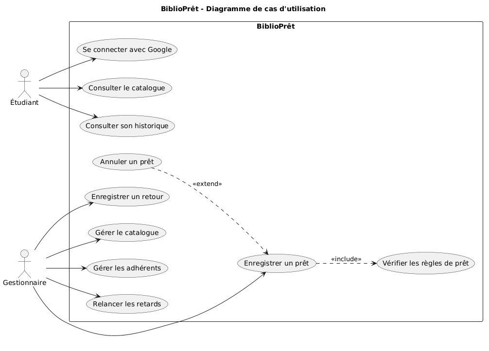
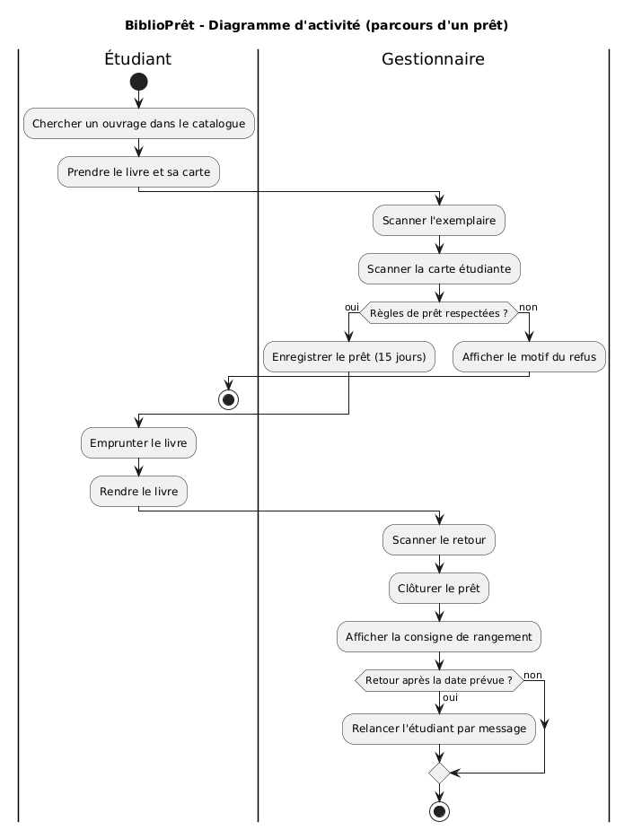
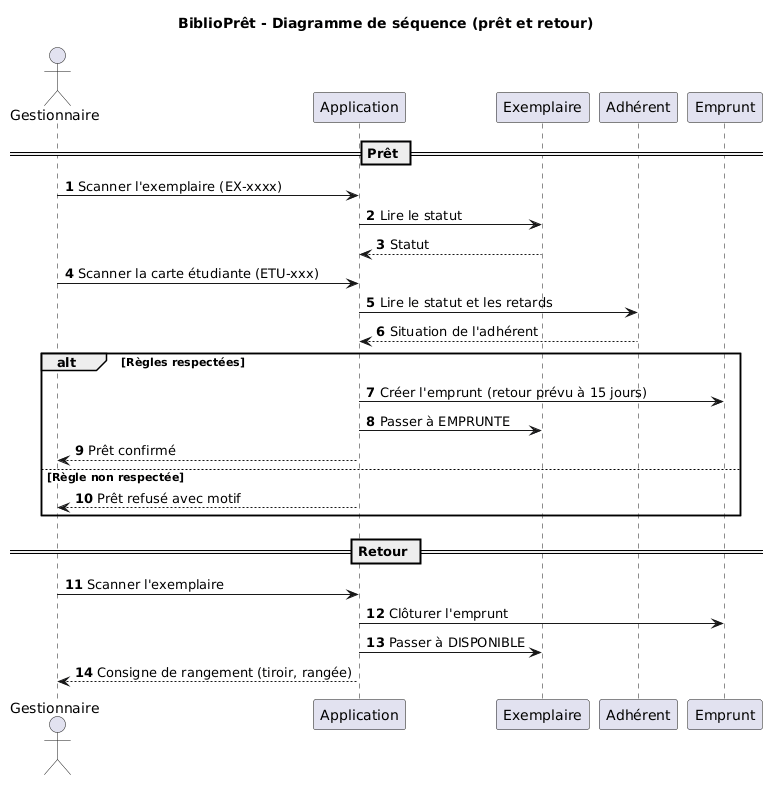

# BiblioPrêt : gestion d'une mini-bibliothèque universitaire

Projet de cours de l'EST (Fès) : conception UML puis application de gestion d'une bibliothèque universitaire.

- Application générée avec Google AI Studio

## Diagrammes UML

### Cas d'utilisation

### Activité

### États

### Séquence

### Capture de l'application 
### 1.catalogue des ouvrages

### Authentification Etudiant

### Filtre Avancer

### Espace Gestionnaire

### Espace gestionnaire Page prêt

### Gestion des rappelle/Emprun en retard

### Historique ouvrage en retard

### Espace gestionnaire Page Etudiant ayant emprunter/activité

### Espace Gestionnaire Historique des emprun

